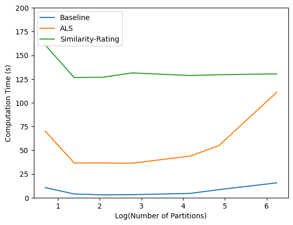

# Review-Based Recommender Systems on Amazon Data with Spark

LSE ST446 Distributed Computing for Big Data group project (2023). We built and compared four rating-prediction models for an Amazon recommender system, two of which use the text of customer reviews, and scaled them on Google Cloud Dataproc with Apache Spark and Hadoop.

📄 **[Read the full report (PDF)](report/st446_project_final_report.pdf)**

## Problem

- Most recommenders rely only on star ratings, which ignores the information in what customers actually write
- Can review text improve rating prediction, and what does it cost to run these models at scale?

## Data

- [Amazon Review Data (2018)](https://cseweb.ucsd.edu/~jmcauley/datasets/amazon_v2/), UCSD: 233M reviews from 1996 to 2018, 34GB compressed
- 19 product categories used, from Magazine Subscriptions (90K reviews) up to Pet Supplies (6.5M reviews)
- 80/20 random train/test split per category

## Models

| Model | Uses review text | Idea |
|---|---|---|
| Baseline Rating | No | Global mean + reviewer bias + product bias |
| ALS | No | Matrix factorisation with Spark MLlib (10 latent factors, λ = 0.2) |
| Similarity-Rating | Yes | Word2Vec embeddings of a reviewer's past reviews vs other reviews of the product, one vector per star rating → predict the rating with the highest cosine similarity |
| Sentiment-Feature | Yes | Top 3 TF-IDF features per reviewer → VADER sentiment of the words around those features in the product's reviews |

Text pre-processing: lowercasing, punctuation stripping, stop-word removal and lemmatisation with NLTK.

## Distributed computing

- **Google Cloud Dataproc** cluster running Hadoop (HDFS) and Spark
- Every model works end to end in **PySpark DataFrames** (`groupBy`, `join`, `explode`, aggregations), only converting to pandas for final metrics
- **Partitioning trials**: 7 partition settings (2 to 512) × 4 models × 2 datasets, recording error metrics and run time

## Results

Average across categories:

| Model | MSE | RMSE | MAE |
|---|---|---|---|
| **Baseline Rating** | **1.578** | **1.246** | **0.892** |
| Similarity-Rating | 1.782 | 1.325 | 0.910 |
| Sentiment-Feature | 3.012 | 1.735 | 1.615 |
| ALS | 3.548 | 1.860 | 1.533 |



Takeaways:
- The simple baseline was hardest to beat, but the untuned Similarity-Rating model came close, so review text carries useful signal
- Partitioning matters: on Luxury Beauty, ALS ran in 36s at 8 to 16 partitions vs 70s at 2 and 111s at 512
- The optimal partition count stayed roughly the same even when the dataset was 6x larger
- Next steps: tune Word2Vec and TF-IDF settings, try more worker nodes and memory, scale to the 10M+ review categories

## Repository structure

```
├── notebooks/
│   ├── models_by_category/   # All four models run per product category
│   ├── partition_trials/     # Run time vs partition count (Magazine, Luxury Beauty)
│   └── utils/                # ALS prototype, script that collects metrics across notebooks
└── report/                   # Final report (PDF, LaTeX source, figures)
```

Notebooks were run on a Dataproc cluster with the data in HDFS; outputs are kept so results can be read without rerunning.

## My contributions

- Built the **ALS** model with Spark MLlib: reviewer-product matrix factorisation, latent factor and regularisation settings
- Co-developed the **Sentiment-Feature** model: TF-IDF feature extraction per reviewer, VADER sentiment on the words around each feature
- Scaled the models with Hadoop and Spark on Google Cloud Dataproc

## Team and credits

Group project with two LSE MSc classmates (Group 19). All members contributed to scaling the models on Google Cloud. Original course repository: `lse-st446/project-2023-group-19` (private).

Dataset: Jianmo Ni, Jiacheng Li and Julian McAuley, *Justifying recommendations using distantly-labeled reviews and fine-grained aspects*, EMNLP 2019.
